# Game Emoji Lite / 游戏轻量表情库

从 [EmojiPackage](https://github.com/wangmiao033/EmojiPackage/tree/6110519a8340b36ae3497c4b062292ca25291b61) 精选的轻量聊天素材候选库，供游戏聊天 UI 原型、联调及版权审核使用。

## v1.1.0 · 扩充至 100 张

- 静态 85 张（221.69 KiB），动态 15 张（57.38 KiB）。
- 图片合计 285776 bytes（279.08 KiB）；86 张不超过 5 KiB；最大 7.43 KiB。
- 新增 68 张，原 ID 001–032、路径及图像字节不变；新增 ID 033–100。
- 原图未重新编码；1 KiB = 1024 bytes；大小不含说明文件与引擎导入开销。
- 本库为候选素材，不代表取得商业授权。正式发行前必须逐张进行版权与内容审核。

| 分类 | 数量 |
| --- | ---: |
| 小鹦鹉 | 53 |
| 滑稽 | 14 |
| 聊天互动 | 18 |
| 组队与大佬 | 6 |
| 夸奖与点赞 | 9 |

## 表情预览（按系列）

### 小鹦鹉

| 表情 | 表情 | 表情 | 表情 |
| --- | --- | --- | --- |
| 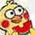 001 吃瓜 1.07 KiB | 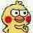 002 思考 1.07 KiB | 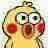 003 吃惊 1.25 KiB |  004 呆滞 1.12 KiB |
|  005 喜欢 1.57 KiB | 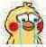 006 伤心 1.38 KiB |  007 大哭 1.23 KiB |  008 坏笑 1.22 KiB |
|  009 期待 1.25 KiB |  010 点赞 1.31 KiB | 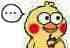 011 无语 1.47 KiB | 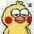 012 犯困 1.31 KiB |
|  013 睡觉 1.25 KiB |  014 问号 2.18 KiB |  015 怀疑 1.69 KiB | 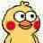 016 看着你 1.26 KiB |
| 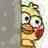 017 偷看 2.63 KiB |  018 喝水 1.33 KiB |  019 吃面 1.28 KiB | 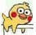 020 躺平 1.48 KiB |
|  021 耍酷 3.45 KiB | 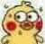 022 愣住 1.34 KiB |  023 捂嘴哭 1.44 KiB | 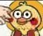 024 捏脸 2.26 KiB |
| 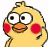 025 挠头 1.94 KiB · GIF |  026 摇气球 2.02 KiB · GIF |  027 喝奶茶 2.03 KiB · GIF | 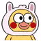 028 兔耳朵 2.47 KiB · GIF |
|  029 精神抖擞 3.05 KiB · GIF |  030 瞪大眼 3.58 KiB · GIF | 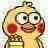 031 吃爆米花 3.84 KiB · GIF |  032 玩手机 4.41 KiB · GIF |
| 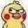 033 不爽 1.06 KiB | 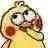 034 吃手手 1.08 KiB | 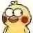 035 斜眼看 1.13 KiB | 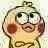 036 幻想 1.16 KiB |
| 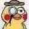 037 放大看 1.23 KiB | 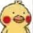 038 瞪小眼 1.29 KiB | 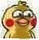 039 鬼魅一笑 1.29 KiB |  040 脑壳疼 1.37 KiB |
| 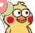 041 手拿气球 1.45 KiB | 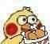 042 吃鸡 1.48 KiB | 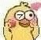 043 抛媚眼 1.55 KiB | 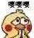 044 嘤嘤嘤 1.63 KiB |
| 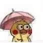 045 打伞 1.69 KiB | 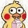 046 喝牛奶 3.02 KiB |  047 长发飘飘 2.36 KiB · GIF | 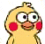 048 摇鸡毛 3.58 KiB · GIF |
| 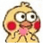 049 小心心 6.12 KiB · GIF | 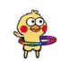 050 转呼啦圈 6.33 KiB · GIF | 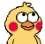 051 眼睛旋转 7.11 KiB · GIF |  052 跃跃欲试 5.51 KiB |
| 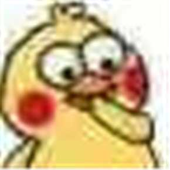 053 不可思议 7.26 KiB |   |   |   |

### 滑稽

| 表情 | 表情 | 表情 | 表情 |
| --- | --- | --- | --- |
| 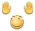 054 投降 0.72 KiB | 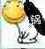 055 背锅 1.06 KiB |  056 超怂 1.20 KiB |  057 震惊 1.61 KiB |
| 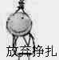 058 放弃挣扎 1.81 KiB |  059 惊吓 2.10 KiB |  060 不好，是大佬 2.12 KiB |  061 别看，会学坏 2.23 KiB |
|  062 我不听 2.33 KiB |  063 抱抱 2.78 KiB · GIF |  064 技不如人，甘拜下风 3.14 KiB |  065 严肃点 3.48 KiB |
| 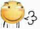 066 叹气 3.63 KiB |  067 滑稽 7.43 KiB |   |   |

### 聊天互动

| 表情 | 表情 | 表情 | 表情 |
| --- | --- | --- | --- |
| 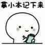 068 拿小本记下来 1.39 KiB | 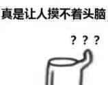 069 真是让人摸不着头脑 1.94 KiB |  070 高手，看不透 2.38 KiB | 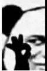 071 OK 2.47 KiB |
| 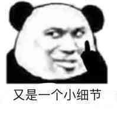 072 又是一个小细节 3.19 KiB | 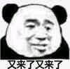 073 又来了又来了 3.49 KiB |  074 我的天呐 3.57 KiB | 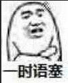 075 一时语塞 4.48 KiB |
| 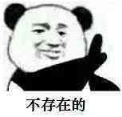 076 不存在的 4.80 KiB | 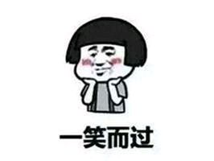 077 一笑而过 5.02 KiB | 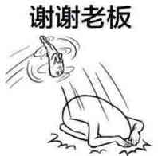 093 谢谢老板 4.69 KiB | 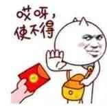 094 哎呀，使不得 5.44 KiB |
| 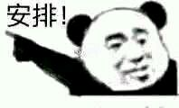 095 安排 4.18 KiB | 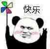 096 快乐 1.68 KiB | 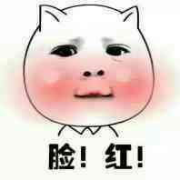 097 脸红 3.55 KiB | 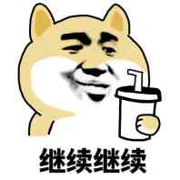 098 继续继续 4.48 KiB |
|  099 害怕 5.78 KiB · GIF |  100 我正在飞速登录 7.18 KiB |   |   |

### 组队与大佬

| 表情 | 表情 | 表情 | 表情 |
| --- | --- | --- | --- |
|  078 给大佬递茶 1.57 KiB |  079 大佬，带我，我会喊666 3.66 KiB |  080 给大佬递可乐B 4.21 KiB |  081 面对一群大佬瑟瑟发抖 4.85 KiB |
|  082 大佬讲话，赶紧做笔记 5.94 KiB |  092 对不起，我是全群最菜的 4.70 KiB |   |   |

### 夸奖与点赞

| 表情 | 表情 | 表情 | 表情 |
| --- | --- | --- | --- |
|  083 竖大拇指 0.53 KiB |  084 六 1.57 KiB |  085 满分 2.45 KiB |  086 真好 2.80 KiB |
|  087 666 2.91 KiB |  088 一级棒 3.29 KiB |  089 妙 5.06 KiB |  090 优秀 5.06 KiB |
|  091 小花花送给你 6.30 KiB |   |   |   |

## 接入方式

- `emoji/static/`：静态 JPG/PNG/JPEG；`emoji/animated/`：GIF 动态资源。
- `manifest.json`：稳定 ID、英文 key、中文名称、分类、文件格式、路径、原始字节数及来源。
- 建议客户端按类别显示面板，并仅传输表情 ID，例如 `{"type":"emoji","id":10}`。服务端校验 ID 白名单、消息频率和发送权限，不接收任意图片 URL。
- 纯图建议 32–48 px，带文字表情建议独立较大贴纸位（约 80–120 px，按原图比例及可读性调整）；原图低分辨率、白底、长宽比差异需在实际 UI 测试。
- GIF 必须先确认引擎支持并测试动画、内存与帧率；不支持时隐藏 GIF 入口。原始文件体积不等同于引擎打包后体积。
- 扩展时仅追加 ID，不重用旧 ID；未知 ID 显示占位符。

## 版权与来源

源仓库声明 Apache-2.0，原收集项目为 [getActivity/EmojiPackage](https://github.com/getActivity/EmojiPackage)。保留原仓库 LICENSE，但无法确认所收集第三方素材的原始权属，尤其是真人或知名表情 IP。原许可证仅在其适用范围内有效，不自动授权第三方图片。素材大小和分类已核对；内容仅经文件名初筛与部分样图抽查，正式商用前请逐张审核，不要直接用于未经授权的商业发行。
