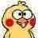
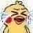
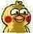
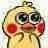
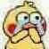
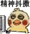
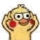
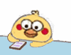

# Game Emoji Lite / 游戏轻量表情库

从 [EmojiPackage](https://github.com/wangmiao033/EmojiPackage/tree/6110519a8340b36ae3497c4b062292ca25291b61) 的小鹦鹉目录精选，供游戏聊天 UI 原型、联调与版权审核使用。

- 版本：v1.0.0
- 24 张静态图 + 8 张 GIF，共 32 张。
- 静态：37716 bytes（36.83 KiB）；动态：23894 bytes（23.33 KiB）；合计：61610 bytes（60.17 KiB）。不含说明文档；1 KiB = 1024 bytes。
- 所有图像均保留原始字节，不重新编码；使用稳定的数字 ID 和英文文件名。
- 这是候选素材库，**不代表获得商业使用授权**。正式发行前必须确认每张图像的授权并审核内容。

## 静态表情（推荐默认启用）

|  |  |  |  |
| --- | --- | --- | --- |
| 001 吃瓜 1.07 KiB | 002 思考 1.07 KiB | 003 吃惊 1.25 KiB | 004 呆滞 1.12 KiB |
|  |  |  |  |
| 005 喜欢 1.57 KiB | 006 伤心 1.38 KiB | 007 大哭 1.23 KiB | 008 坏笑 1.22 KiB |
|  |  |  |  |
| 009 期待 1.25 KiB | 010 点赞 1.31 KiB | 011 无语 1.47 KiB | 012 犯困 1.31 KiB |
|  |  |  |  |
| 013 睡觉 1.25 KiB | 014 问号 2.18 KiB | 015 怀疑 1.69 KiB | 016 看着你 1.26 KiB |
|  |  |  |  |
| 017 偷看 2.63 KiB | 018 喝水 1.33 KiB | 019 吃面 1.28 KiB | 020 躺平 1.48 KiB |
|  |  |  |  |
| 021 耍酷 3.45 KiB | 022 愣住 1.34 KiB | 023 捂嘴哭 1.44 KiB | 024 捏脸 2.26 KiB |

## 动态表情（客户端支持 GIF 时启用）

|  |  |  |  |
| --- | --- | --- | --- |
| 025 挠头 1.94 KiB | 026 摇气球 2.02 KiB | 027 喝奶茶 2.03 KiB | 028 兔耳朵 2.47 KiB |
|  |  |  |  |
| 029 精神抖擞 3.05 KiB | 030 瞪大眼 3.58 KiB | 031 吃爆米花 3.84 KiB | 032 玩手机 4.41 KiB |

## 接入方式

- 客户端内置 `emoji/static/` 和 `manifest.json`；支持 GIF 时内置 `emoji/animated/`。
- 聊天仅发送稳定表情 ID，例如 `{"type":"emoji","id":10}`。服务端校验 ID 白名单、消息频率和发送权限，不接收玩家提供的任意图片 URL。
- 显示建议：32–48 px，按原图比例显示，不强制拉伸。原图低分辨率或白底时须检查深色聊天背景效果。
- GIF 解码能力因引擎而异，发布前测试帧率、内存占用和播放上限；不支持 GIF 时隐藏动态表情入口。
- 新增表情只追加 ID，不能重用旧 ID；客户端遇到未知 ID 时显示占位符。
- `manifest.json`：完整机器可读 ID、路径、中文名、源文件、格式和字节数。实际包体取决于游戏引擎的导入和压缩方式。

## 版权与来源

源仓库声明 Apache-2.0，来源项目为 [getActivity/EmojiPackage](https://github.com/getActivity/EmojiPackage)。本库保留原仓库 LICENSE，但不能确认收集的第三方图片原作者或商业授权。原许可证仅在其适用范围内有效，不构成对第三方图片的额外授权。请勿未经权利核实直接用于正式商业发布。
