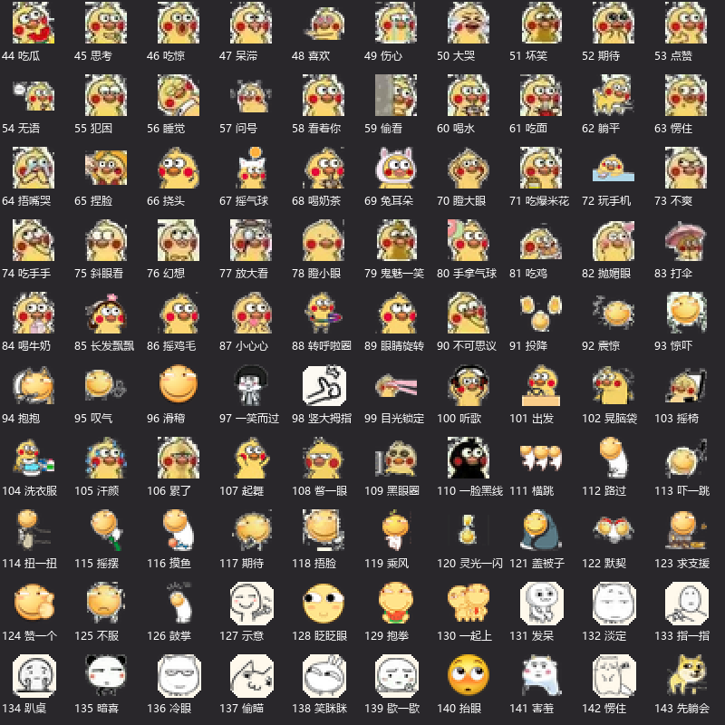

# 游戏聊天轻量表情

当前版本收录 100 张适配 24×24 聊天格的静态透明 PNG。保留原轻量库筛出的 55 张，再从同仓库 master 精选 45 张。单图合计 164,358 字节，最大 1,992 字节。

[下载分支 ZIP](https://github.com/wangmiao033/EmojiPackage/archive/refs/heads/game-emoji-lite.zip) · [编号与来源清单](manifest.json) · [Egret 图集](game24.png) · [图集索引](game24.json)

游戏原有 1～43 号由游戏提供。本包追加 44～143，44～98 与上一版已筛出的 55 张对应，99～143 为 master 补选。PNG 原件在 game24 目录。清单的 game_id 对应游戏编号，id 为素材库编号。历史素材编号不复用，旧版原文件路径保留，见[旧版清单](archive/v1.1.0-manifest.json)。

每张图记录上游路径、原始大小、哈希以及代表帧。处理包括等比缩放、按需裁切和边缘去底。GIF 取静态帧以兼容原游戏图集。

## 来源与使用

图片均取自本仓库。[master 来源版本](https://github.com/wangmiao033/EmojiPackage/tree/6110519a8340b36ae3497c4b062292ca25291b61)，[轻量库来源版本](https://github.com/wangmiao033/EmojiPackage/tree/5b0c37737511da07158267001889d46e87857887)。仓库保留原有 LICENSE，所收集的第三方图片权属以各素材实际授权为准。
